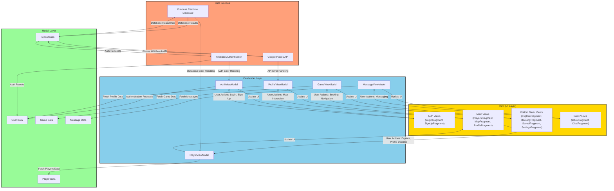

# HoopHub

HoopHub is a Kotlin Android application developed by a four-person team for SFU CMPT 362. It helps basketball players discover nearby courts, manage profiles, organize games, and connect with other players.

The app uses MVVM and repository-based data flows to separate UI, application state, and external data sources such as Firebase and the Google Places API.

## Key Features

* Discover nearby basketball courts using the user’s current location
* View courts on an interactive Google Map
* Create and join basketball games
* Manage player profiles and authentication
* Message other players
* Store and retrieve application data through Firebase

## Tech Stack

* Kotlin
* Android SDK
* Jetpack Compose and Fragments
* MVVM and Repository Pattern
* Firebase Authentication and Realtime Database
* Google Maps and Places APIs
* Retrofit

## Team Contributions

| Team Member         | Primary Contributions                                                                                                 |
| ------------------- | --------------------------------------------------------------------------------------------------------------------- |
| Taiga Okuma         | Defined the MVVM/repository structure and data flow; built nearby-court discovery and Google Maps/Places integration. |
| Kristina Tretiakova | Implemented Firebase authentication, database and storage integration, and profile image retrieval.                   |
| Jeffrey Loverock    | Built the initial UI structure, ProfileFragment, and profile editing and deletion flows.                              |
| Paul Atwal          | Implemented player-related screens and functionality.                                                                 |

## Architecture

HoopHub follows an MVVM-based architecture:

* **Views:** Activities, Fragments, and Jetpack Compose screens
* **ViewModels:** Manage UI state and coordinate application logic
* **Repositories:** Provide access to Firebase and external APIs
* **Data Sources:** Firebase Authentication, Firebase Database, and Google Places

#### **MVVM Flow Diagram**:


---

### **Thread Management**
To handle operations efficiently, HoopHub uses background threads for API calls and database interactions, ensuring the main thread remains responsive for user actions.

#### **Thread Management Diagram**:

```mermaid
graph TB
    subgraph MainThread["Main Thread"]
        A1["MainActivity (UI Thread)"]
        A2["Fragment Management"]
        A3["Event Handlers (User Input)"]
    end

    subgraph ViewModels["ViewModels (Logic Layer)"]
        B1["AuthViewModel"]
        B2["GameViewModel"]
        B3["MessageViewModel"]
        B4["PlayerViewModel"]
        B5["ProfileViewModel"]
    end

    subgraph BackgroundThreads["Background Threads"]
        C1["Network Operations"]
        C2["Firebase Auth / Realtime DB"]
        C3["Google Places API"]
    end

    subgraph Models["Models (Data Layer)"]
        D1["User Data"]
        D2["Game Data"]
        D3["Messages Data"]
        D4["Players Data"]
        D5["Court Data"]
    end

    %% Main Thread Connections
    A1 -->|Manages UI Updates| A2
    A1 -->|Triggers Logic Requests| B1
    A2 -->|Routes User Events| A3

    %% ViewModel to Background Threads
    B1 -->|Firebase SignIn/SignUp| C2
    B2 -->|Fetch/Update Game Data| C2
    B3 -->|Send/Receive Messages| C2
    B4 -->|Fetch/Update Player Data| C2
    B5 -->|Fetch/Update Profile Data| C2

    %% Background Threads to Models
    C2 -->|Retrieve/Store Auth Data| D1
    C2 -->|Retrieve/Store Game Info| D2
    C2 -->|Retrieve/Store Messages| D3
    C2 -->|Retrieve/Store Player Data| D4
    C3 -->|Retrieve Court Data| D5

    %% Background Threads to ViewModels
    C2 -->|Return Auth Status| B1
    C2 -->|Return Game Data| B2
    C2 -->|Return Messages| B3
    C2 -->|Return Player Data| B4
    C3 -->|Return Court Data| B5

    %% ViewModels to Main Thread
    B1 -->|Update Auth UI| A1
    B2 -->|Update Game UI| A1
    B3 -->|Update Message UI| A1
    B4 -->|Update Player UI| A1
    B5 -->|Update Profile UI| A1

    %% Styling
    style MainThread fill:#FFD700,stroke:#333,stroke-width:2px
    style ViewModels fill:#87CEEB,stroke:#333,stroke-width:2px
    style BackgroundThreads fill:#98FB98,stroke:#333,stroke-width:2px
    style Models fill:#FFA07A,stroke:#333,stroke-width:2px

    %% Node Styles
    style A1 fill:#FFD700,stroke:#000,stroke-width:2px
    style A2 fill:#FFD700,stroke:#000,stroke-width:2px
    style A3 fill:#FFD700,stroke:#000,stroke-width:2px
    style B1 fill:#87CEEB,stroke:#000,stroke-width:2px
    style B2 fill:#87CEEB,stroke:#000,stroke-width:2px
    style B3 fill:#87CEEB,stroke:#000,stroke-width:2px
    style B4 fill:#87CEEB,stroke:#000,stroke-width:2px
    style B5 fill:#87CEEB,stroke:#000,stroke-width:2px
    style C1 fill:#98FB98,stroke:#000,stroke-width:2px
    style C2 fill:#98FB98,stroke:#000,stroke-width:2px
    style C3 fill:#98FB98,stroke:#000,stroke-width:2px
    style D1 fill:#FFA07A,stroke:#000,stroke-width:2px
    style D2 fill:#FFA07A,stroke:#000,stroke-width:2px
    style D3 fill:#FFA07A,stroke:#000,stroke-width:2px
    style D4 fill:#FFA07A,stroke:#000,stroke-width:2px
    style D5 fill:#FFA07A,stroke:#000,stroke-width:2px


```


---

## **App Structure**

```plaintext
com.example.hoophub
├── ApiUtils.kt
├── AuthHostActivity.kt
├── MainActivity.kt
├── ProfileImageLauncher.kt
├── ProfileUtil.kt
├── SplashActivity.kt
├── ViewModel
│   ├── AuthViewModel.kt
│   ├── GameViewModel.kt
│   ├── MessageViewModel.kt
│   ├── PlayerViewModel.kt
│   └── ProfileViewModel.kt
├── adapter
│   ├── BookingCardAdapter.kt
│   ├── ChatAdapter.kt
│   ├── DialogAdapter.kt
│   ├── GameAdapter.kt
│   ├── MessageAdapter.kt
│   ├── ParticipantAdapter.kt
│   ├── PlayerCardAdapter.kt
│   ├── SearchAdapter.kt
│   └── ViewPagerAdapter.kt
├── data
│   ├── BasketballCourt.kt
│   └── PlaceApiResponse.kt
├── factory
│   ├── AuthViewModelFactory.kt
│   ├── MessageViewModelFactory.kt
│   └── ProfileViewModelFactory.kt
├── fragment
│   ├── Auth
│   │   ├── LoginFragment.kt
│   │   └── SignUpFragment.kt
│   ├── BottomMenu
│   │   ├── BookingFragment.kt
│   │   ├── ExploreFragment.kt
│   │   ├── SavedFragment.kt
│   │   └── SettingsFragment.kt
│   ├── GamesFragment.kt
│   ├── Inbox
│   │   ├── ChatFragment.kt
│   │   └── InboxFragment.kt
│   ├── InviteBottomSheetFragment.kt
│   ├── MainFragment.kt
│   └── TopMenu
│       ├── EditProfileFragment.kt
│       ├── MapFragment.kt
│       ├── MapPopupFragment.kt
│       ├── MapScreen.kt
│       ├── MapSelectionScreen.kt
│       ├── PlayersFragment.kt
│       └── ProfileFragment.kt
├── model
│   ├── BookingCard.kt
│   ├── Dialog.kt
│   ├── Game.kt
│   ├── Message.kt
│   ├── PlayerCard.kt
│   └── User.kt
├── network
│   └── GooglePlacesAPI.kt
└── repository
    ├── AuthRepository.kt
    ├── GamesRepository.kt
    ├── MessageRepository.kt
    ├── PlayersRepository.kt
    ├── ProfileRepository.kt
    └── UserRepository.kt

```

---

## **Getting Started**

### **1. Prerequisites**
- **Android Studio**: Install the latest version.
- **Google Maps API Key**: Obtain your API key and configure it in the project.

### **2. Setting up `local.properties`**
1. **Create the `local.properties` file** in the root directory of the project.
2. Add the following entries to the file:
   ```properties
   MAPS_API_KEY=your_api_key_here   # Replace with the API key provided in Canvas
   sdk.dir=/Users/<your_username>/Library/Android/sdk   # Update this path based on your system
   ```

   **Note**:
    - macOS: `/Users/<your_username>/Library/Android/sdk`
    - Windows: `C:\\Users\\<your_username>\\AppData\\Local\\Android\\sdk`
    - Linux: `/home/<your_username>/Android/Sdk`

### **3. Clone the Repository**
Clone the repository using the following command:
```bash
git clone <repository-url>
```

### **4. Open in Android Studio**
- Launch Android Studio and open the project directory.

### **5. Build and Run**
- Add your Google Maps API key in `local.properties`.
- Build the project and run it on an emulator or a physical device.

### **6. Login**
- Use demo user:
    - Email: `emma@gmail.com`
    - Password: `emma123`
- Note: If the navigation bar at the bottom does not appear when you first run the app, try restarting the app. This issue may occur in some environments.
- Enjoy the app!
---
